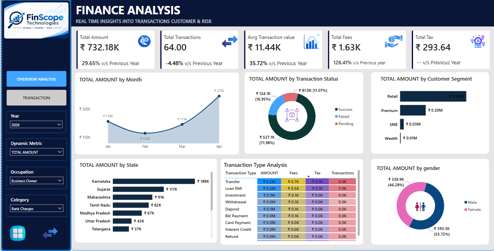
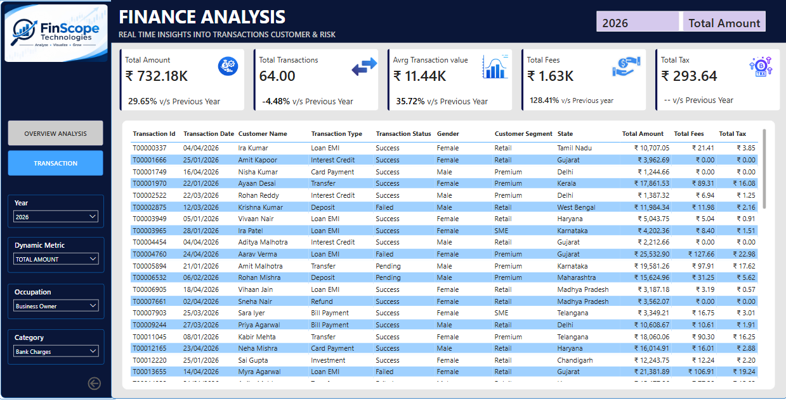

# 💰 FinScope Technologies – Finance Analysis Dashboard

## 📌 Project Overview

The FinScope Technologies Finance Analysis project focuses on analyzing financial transactions, customer behavior, transaction performance, fees, and taxes using Microsoft Power BI.

The project provides an interactive dashboard that helps business stakeholders monitor financial performance, identify transaction trends, understand customer segments, and evaluate regional performance through meaningful visual insights.

## 🎯 Business Objectives

- Monitor overall financial transaction performance.
- Analyze monthly transaction amount trends.
- Compare successful, failed, and pending transactions.
- Identify high-performing customer segments.
- Evaluate state-wise financial performance.
- Analyze transaction types and their financial contribution.
- Understand customer demographics based on gender.
- Compare Year-over-Year (YoY) performance.

## 🛠️ Tools & Technologies

- **Microsoft Power BI** – Dashboard development and data visualization.
- **Power Query** – Data cleaning and transformation.
- **DAX** – Calculations, KPIs, and dynamic measures.
## 📊 Dashboard Features

### 1. Overview Analysis

Provides a comprehensive view of financial performance through interactive visualizations.

**Key Performance Indicators (KPIs):**
- Total Amount
- Total Transactions
- Average Transaction Value
- Total Fees
- Total Tax

**Visualizations:**
- Total Amount by Month – Analyzes monthly financial trends.
- Total Amount by Transaction Status – Compares successful, failed, and pending transactions.
- Total Amount by Customer Segment – Evaluates customer segment contributions.
- Total Amount by State – Identifies top-performing states.
- Transaction Type Analysis – Compares amount, fees, tax, and transaction count.
- Total Amount by Gender – Analyzes financial contributions by gender.

### 2. Transaction Analysis

Provides a detailed transaction-level view to analyze individual financial records.

**Transaction Details Include:**
- Transaction ID
- Transaction Date
- Customer Name
- Transaction Type
- Transaction Status
- Gender
- Customer Segment
- State
- Total Amount
- Total Fees
- Total Tax

## 🎛️ Interactive Filters

The dashboard includes interactive slicers for dynamic analysis:

- Year
- Dynamic Metric
- Occupation
- Category

These filters allow users to explore financial data based on different business requirements.

## 📈 Key Insights

The dashboard helps identify:

- Monthly changes in financial transaction amounts.
- Transaction success and failure patterns.
- Customer segments contributing the highest transaction value.
- States generating higher financial transaction amounts.
- Performance differences across transaction categories.
- Gender-based transaction contribution.
- Year-over-Year changes in financial KPIs.

## 💡 Business Benefits

- Provides a centralized view of financial performance.
- Supports data-driven business decisions.
- Improves transaction monitoring and analysis.
- Helps identify customer behavior and financial trends.
- Enables detailed transaction-level investigation.
- Simplifies financial reporting through interactive dashboards.

## 📷 Dashboard Preview

### Overview Analysis

### Transaction Analysis

## 📁 Project Structure

FinScope-Technologies-Finance-Analysis/
│
├── Dashboard/
│   └── Finance_Analysis.pbix
│
├── Screenshots/
│   ├── Overview_Analysis.png
│   └── Transaction_Analysis.png
│
├── Documentation/
│   └── Business_Requirements_Document.docx
│
└── README.md

## 🏁 Conclusion

The FinScope Technologies Finance Analysis Dashboard transforms financial transaction data into meaningful business insights using Power BI.

Through interactive visualizations, KPI monitoring, and detailed transaction analysis, this project demonstrates how business intelligence tools can support financial performance monitoring and effective decision-making.

---
**Project Name:** FinScope Technologies – Finance Analysis

**Domain:** Finance & Banking Analytics

**Tool:** Microsoft Power BI
